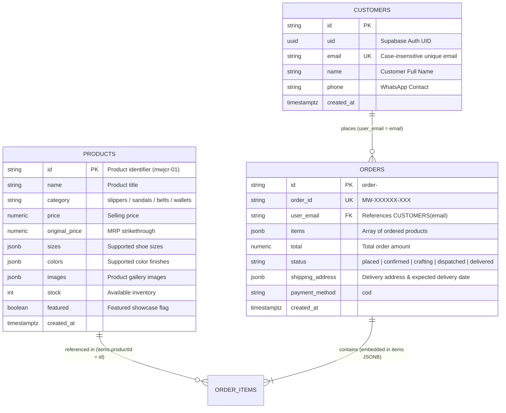

# MAXYWALK — DATABASE ENTITY RELATIONSHIPS

## Relational Characteristics
1. **Denormalized Order Items**:
   - In accordance with modern e-commerce best practices, line items are stored as a JSONB array inside `orders.items`. This preserves immutable historical snapshots of product title, size, color, unit price, and image at the exact time of purchase, preventing historical order corruption if a product's price or description changes later.
2. **Denormalized Shipping Address**:
   - `orders.shipping_address` contains customer delivery details including street, city, state, pincode, phone number, and `expected_delivery_date`.
3. **Customer to Order Relationship**:
   - Joined via `orders.user_email = customers.email`.
   - Supports both authenticated customer orders and guest checkouts seamlessly.
